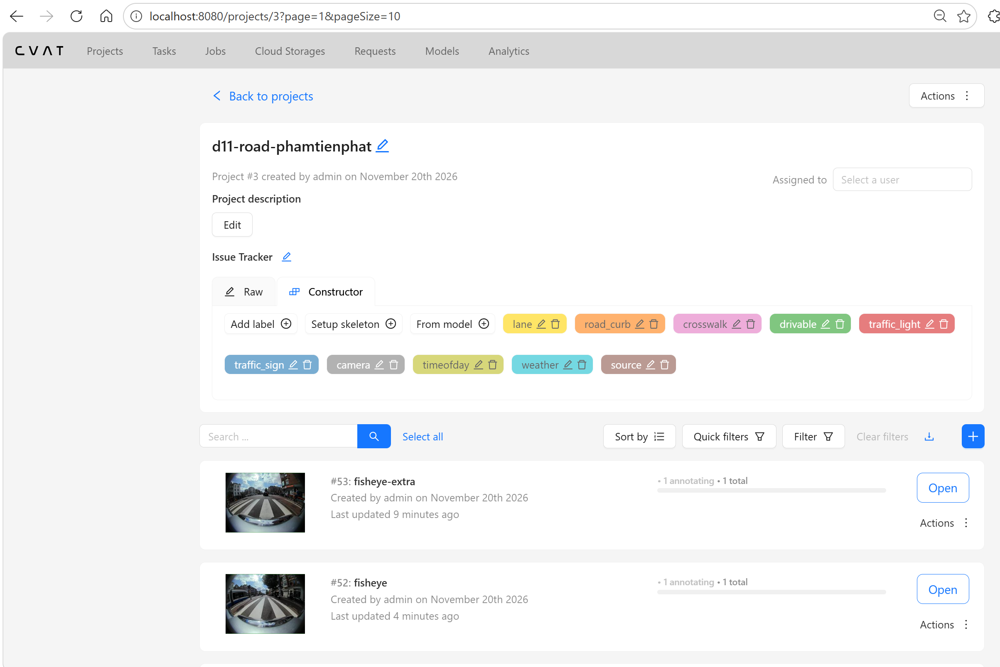
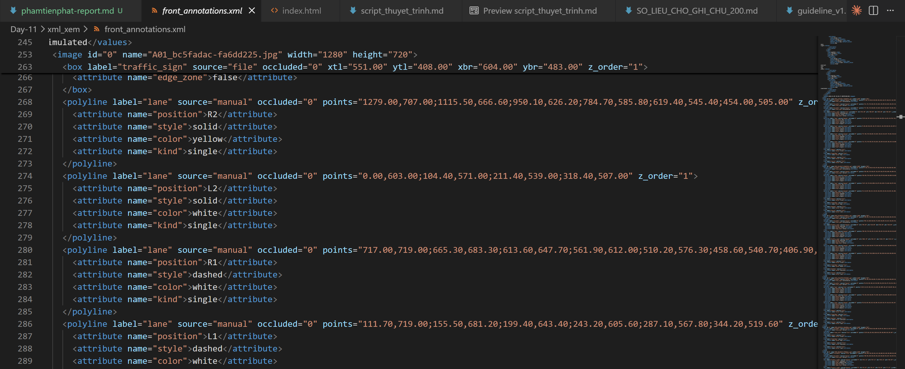

# Báo cáo cá nhân — Ngày 11
Họ tên: Phạm Tiến Phát      Mã học viên: 03063  
Phiên bản CVAT (Help → About): 2.74.1  
Guideline: Road v1.0    Lần nộp (`revision` trong manifest): 2  
Thời điểm export (ngày giờ trên CVAT): 21/11/2026 14:17 (revision 1: 21/11/2026 02:49)    Số lần nộp lại sau Rework: 1  

## 1. Kiểm project
| Mục | Đúng như guideline Road v1.0? | Ghi chú |
| --- | --- | --- |
| 6 label, đúng kiểu | Đúng | lane, road_curb (polyline); crosswalk, drivable (polygon); traffic_light, traffic_sign (rectangle) |
| Thuộc tính và giá trị | Đúng | so với `python -m road_lab.taxonomy` / `configs/road_v1_labels.json` |
| 4 tag ảnh | Đúng | camera, timeofday, weather, source; mỗi label Tag có một thuộc tính select `value` |

Cách kết thúc polyline trên bản CVAT này: bấm phím N sau điểm cuối  
Cách đặt tag ảnh trên bản CVAT này: công cụ Tag ở thanh bên trái → chọn label (camera/timeofday/weather/source) → mở Details trong bảng Objects để chọn `value`  

## 2. Số lượng đã gán
| Task | Ảnh | lane | road_curb | crosswalk | drivable | traffic_light | traffic_sign |
| --- | ---: | ---: | ---: | ---: | ---: | ---: | ---: |
| front | 12 | 26 | 3 | 4 | 22 | 17 | 11 |
| front-extra (đã làm 4 / 4) | 4 | 11 | 0 | 2 | 8 | 6 | 10 |
| fisheye | 8 | 6 | 9 | 11 | 5 | 6 | 4 |
| fisheye-extra (đã làm 4 / 4) | 4 | 0 | 4 | 4 | 2 | 0 | 0 |

## 3. Bảng ca khó
| Ảnh | Nhãn | Phân vân giữa | Đã chọn | Lý do |
| --- | --- | --- | --- | --- |
| A01 | lane (vạch đứt giữa) | xe đang đi làn phải hay làn trái (camera gần trùng vạch đứt) | làn trái: L1 = vạch đứt trái, R1 = vạch đứt giữa, R2 = vạch vàng | Ở đáy ảnh vạch đứt trái x≈112, vạch đứt giữa x≈717; tâm xe x=640 nằm giữa hai vạch |
| A03 | lane L1 (vạch vàng) | kind double hay single | single | Gần xe có hai vệt vàng nhưng đó là viền dải phân cách sơn (vệt ngoài rẽ thành vạch chéo); từ y≈565 trở lên chỉ còn một vạch. Polyline đặt trên vạch phía trong, sát làn đang đi |
| A05 | lane | để trống, chỉ gán road_curb + drivable | Đường không có vạch sơn; không vẽ vạch không có. Lint báo QC1-02, cần coach xác nhận để được miễn |
| A06 | traffic_light (đèn đi bộ "walk" trắng) | green, facing front | Hình người trắng "WALK" mang nghĩa được đi; Road v1.0 không có giá trị white |
| A08 | traffic_sign "PASSENGER CARS ONLY" | supplementary | Tấm chữ nhật nhỏ đi kèm biển chỉ dẫn chính phía dưới, có hộp riêng |
| A11 | drivable bên phải R1 | dải đỗ xe hay làn xe chạy | alternative tới mép hàng xe đỗ | Ảnh chạng vạng, không có vạch ngăn dải đỗ; SUV đang bật đèn nằm lệch trái hẳn so với hàng xe đỗ nên giữa R1 và hàng xe đỗ còn một làn chạy. Ranh giới ước lượng theo mép trái hàng xe đỗ |
| A12 | lane | chỉ gán L1, để trống R1 | Bên phải gần xe không thấy vạch; lint báo QC1-02, cần coach xác nhận |
| A08 | traffic_light vỏ vàng (3 đèn) | facing side hay back | side, color unknown | Mép vỏ có các chụp che nắng nhô ra kiểu nhìn nghiêng; không thấy mắt đèn nên không biết màu |
| A10 | drivable làn trái (L1 trắng liền) | alternative hay không | alternative | Guideline gán theo "đi được nếu đường trống", không xét luật chuyển làn; làn có ô tô chạy |
| B04 | lane (vạch trắng liền cạnh làn bus, camera sau) | gán lane hay bỏ; nếu gán thì position nào | chưa gán, hỏi coach | Quang nêu trong Phiếu QC 1; trên camera sau trái/phải ảnh bị đảo nên chưa chắc position |
| B03 | lane position (camera sau) | theo hướng xe (trái ảnh = R1) | position tính theo làn đang đi của xe; camera sau nhìn ngược nên trái/phải bị đảo |
| B07 | drivable | không gán drivable | Làn xe đạp, ô tô không chạy vào |
| B11 | lane | không gán lane | Guideline: vạch ô đỗ không gán lane (bẫy QC1-03); ảnh chỉ có tag |

## 4. Phiếu QC 1 nhận được
Bạn kiểm lô của tôi: Nguyễn Văn Quang  Quyết định nhận được: Rework (1 lỗi nặng; lỗi chính 5 / 60 nhãn = 8,3 %)  
Mẫu Quang kiểm: A05, A06, A09, A12, B04, B06 (revision 1).

| Mã lỗi | Số lỗi | Đồng ý? | Đã sửa? |
| --- | ---: | --- | --- |
| QC1-03 (B06, lane `other` dọc dải bê tông) | 1 | Không. Phóng to thấy các đoạn sơn trắng nằm trên mặt đường ở chân dải bê tông, nên đây là vạch sơn chứ không phải mép bê tông; giữ `lane` | Không sửa |
| QC1-07 (A05, `direct` lấn dải đỗ bên phải) | 1 | Không. Kéo mép trái xe đỗ (x ≈ 790, y ≈ 335) về điểm tụ thì ở đáy ảnh dải đỗ bắt đầu từ x ≈ 1180; biên `direct` dừng ở x ≈ 1150, đã nằm ngoài dải đỗ | Không sửa |
| QC1-07 (A12, `direct` dừng ở vạch ngựa vằn) | 1 | Có. Mặt đường sau vạch ngựa vằn vẫn "đi được nếu đường trống", và A06 đã vẽ qua vạch ngựa vằn | Đã sửa: kéo `direct` qua vạch ngựa vằn tới hàng xe đỗ hai bên |
| QC1-06 (A12, L1 ghi `white`) | 1 | Không. L1 đặt trên các vệt đứt màu trắng (RGB ≈ 220, 240, 230); vạch vàng là vạch khác nằm sát vạch ngựa vằn | Không sửa |
| QC1-09 (A12, biển một chiều mép trái gán `prohibitory`) | 1 | Có. One Way thuộc nhóm `mandatory` | Đã sửa: `group = mandatory` |
| QC1-04 (B04, R1 chỉ là đoạn ngắn ở xa) | 1 | Một phần. Vạch đứt chỉ có ở xa, gần xe là chữ BUS nên không kéo dài được; vạch trắng liền cạnh làn bus ghi vào bảng ca khó để hỏi coach | Chỉnh lại hình B04 trên CVAT |

Ca mơ hồ Quang nêu: 7 cảnh báo QC1-02 (A05–A09, A12) chờ coach xác nhận miễn vì không thấy vạch; R1 ở A06 là vạch sơn; tâm hộp ở B04 sát ngưỡng 80 % (biển ≈ 523 px bật `edge_zone`, đèn ≈ 495 px không bật).

Nộp lại revision 2 (21/11/2026): sửa A12 như trên; bổ sung `road_curb` ở B01, B03, B04 và chỉnh `road_curb` B05. Bản revision 1 (hai zip và `phamtienphat-manifest-r1.json`) giữ ở thư mục `r1/`. Tính lại theo phần tôi đồng ý: 0 lỗi nặng, 2 lỗi chính / 60 nhãn = 3,3 % (cả 2 đã sửa ở revision 2).

## 5. Kiểm file export
| File | Mở lại được? | Số shape ảnh 1 (job / file) | Số shape ảnh 2 (job / file) | Tag camera có trong XML? |
| --- | --- | --- | --- | --- |
| phamtienphat-front.zip | Có (`road_check lint`) | A01: 8 / 8 | A02: 5 / 5 | Có |
| phamtienphat-fisheye.zip | Có (`road_check lint`) | B01: 5 / 5 | B02: 7 / 7 | Có |

## 6. Ảnh chụp màn hình
1. Tab Labels của project `d11-road-phamtienphat`: 6 label vẽ và 4 label Tag.

   

2. Ảnh camera trước A16 đã gán đủ: L1, R1, L2, drivable direct và alternative hai bên, crosswalk, đèn, biển.

   

3. Ảnh fisheye B08 (fisheye_right), phóng to đoạn `road_curb` đặt điểm theo cung.

   

4. Một đoạn XML có `<polyline label="lane">` (ảnh A01 trong `phamtienphat-front.zip`).

   

## 7. Tự đánh giá
Lỗi bạn mắc nhiều nhất hôm nay (theo mã QC1-xx), và cách tránh ở Ngày 20: **QC1-07 (vùng lái)** — bỏ sót polygon `drivable` `alternative` cho làn cùng chiều bên cạnh (A01, A02, A03, A10, A11, A13, A16), có chỗ nhầm làn chạy với dải đỗ. Ngoài ra có một lỗi QC1-03 (A01, nhầm làn đang đi nên L1/R1 lệch một vạch) và một lỗi QC1-06 (A03, viền dải phân cách sơn bị gán vạch vàng `double`). Cách tránh ở Ngày 20: (1) trước khi vẽ, đo x của các vạch ở đáy ảnh và so với tâm xe (x = 640) để chốt L1/R1; (2) vẽ xong lane thì đếm số làn cùng chiều giữa các vạch — mỗi làn ô tô chạy được phải có một polygon, dải đỗ và làn xe đạp thì không; (3) vạch vàng chỉ chọn `double` khi hai vệt song song chạy suốt chiều dài, phóng to để kiểm.    
Nhãn của bạn đi vào model ở đâu? Chọn một lỗi đã sửa và nói nó làm model học sai thế nào: Polyline `lane` kèm `position` là đích của model phát hiện làn (kiểu row-anchor: x của từng vạch ở mỗi hàng ảnh), đầu vào của chức năng giữ làn LKA; polygon `drivable` là đích của model phân vùng mặt đường để lập đường đi. Lỗi đã sửa ở A01: xe đang ở làn trái nhưng tôi gán vạch đứt giữa là L1 và vạch vàng là R1. Nếu đi vào dữ liệu huấn luyện, model học rằng làn của xe nằm lệch sang phải một làn; LKA sẽ lấy tâm làn sai và đánh lái về phía làn bên cạnh — vì vậy sai `position` được xếp lỗi nặng.  

## 8. (Tùy chọn, buffer) Từ polyline đến đích row-anchor
| y | 720 | 680 | 640 | 600 | 560 |
| --- | ---: | ---: | ---: | ---: | ---: |
| x của chúng tôi |  |  |  |  |  |
| x của bạn kia |  |  |  |  |  |
